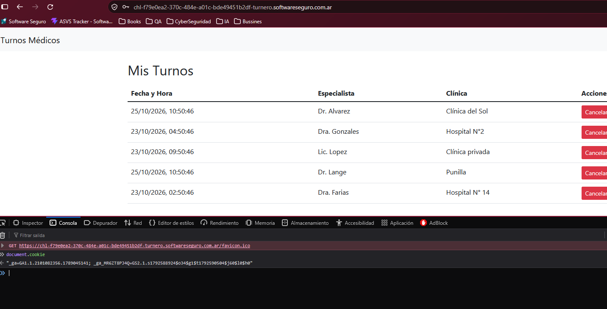
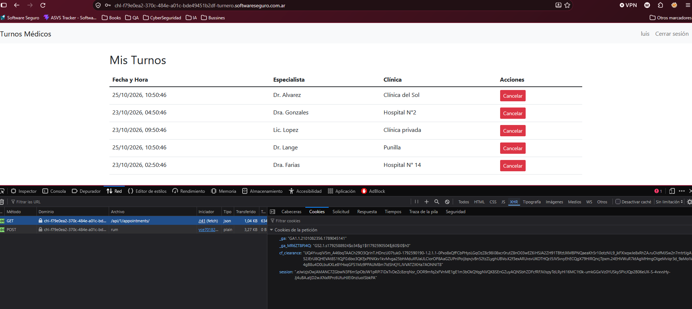
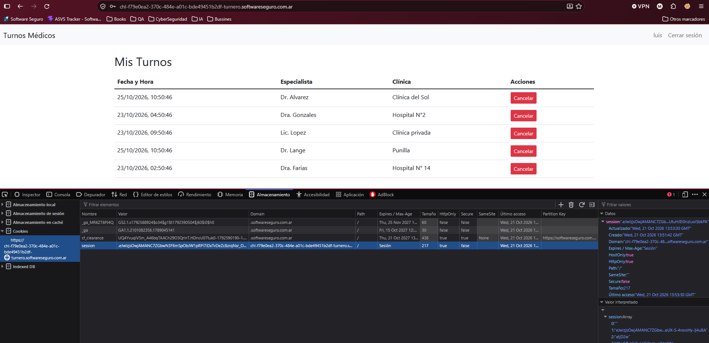
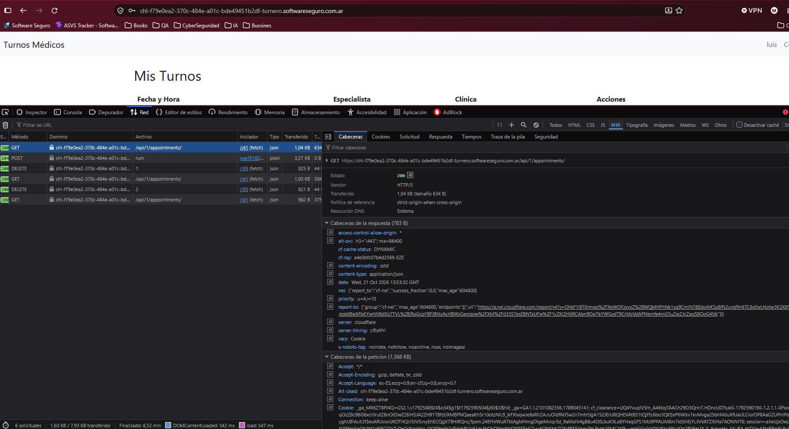
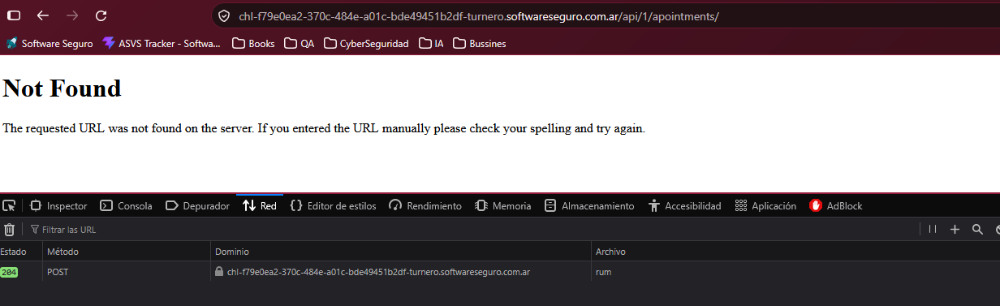

# Transmisión Insegura de la Cookie de Sesión por Ausencia del Flag `Secure` — Alta

## 1. Resumen Ejecutivo

Durante la revisión del laboratorio **Turnero** (Módulo I, Objetivo 2) aplicando lo visto en la Clase 5 sobre Security Misconfiguration, encontré que la cookie `session` — la que identifica la sesión autenticada del usuario — se transmite sin el flag `Secure`, y que además el servidor no envía la cabecera `Strict-Transport-Security` (HSTS). En conjunto, esto significa que si en algún momento el navegador llega a mandar una petición por HTTP en vez de HTTPS (un link viejo, una red comprometida, un ataque de downgrade), la cookie de sesión viaja en texto plano y cualquiera posicionado en esa misma red la puede capturar y secuestrar la sesión de otro usuario sin necesidad de robar ni adivinar ninguna contraseña.

A esto se suma la ausencia total de las demás cabeceras de seguridad HTTP recomendadas (CSP, X-Content-Type-Options, X-Frame-Options, Referrer-Policy, Permissions-Policy), que no generan por sí solas un hallazgo crítico pero debilitan la postura general de seguridad de la aplicación.

**Severidad:** Alta (CVSS 3.1 — 7.4) · **Estado:** Abierto
**Recomendación en una línea:** agregar los flags `Secure` y `SameSite` a la cookie de sesión e implementar HSTS para forzar HTTPS en toda la aplicación.

## 2. Detalles Técnicos

- **Componente afectado:** cookie `session` emitida por el backend de Turnero, visible en cualquier endpoint autenticado (ej. `GET /api/1/appointments/`).
- **Tipo de vulnerabilidad:** `CWE-614` — Sensitive Cookie Without 'Secure' Attribute, agravado por `CWE-319` — Cleartext Transmission of Sensitive Information (al no existir HSTS que fuerce HTTPS).
- **Condiciones necesarias para explotarla:** el atacante necesita estar posicionado en la misma ruta de red que la víctima (red Wi-Fi compartida, router comprometido, MITM) y que en algún momento el navegador de la víctima intente una conexión por HTTP — algo perfectamente posible al no existir HSTS, ya que nada le dice al navegador que rechace esa conexión insegura de entrada.
- **Herramientas usadas:** DevTools de Chrome (Consola, Aplicación → Almacenamiento → Cookies, Red → Cabeceras). Todo el hallazgo se obtuvo de forma 100% pasiva, sin modificar ni reenviar ninguna petición.

### Hallazgo complementario: cabeceras de seguridad ausentes

Revisando las cabeceras de respuesta del mismo endpoint (`GET /api/1/appointments/`), ninguna de las 6 cabeceras de la tabla de la Clase 5 está presente:

| Cabecera | ¿Presente? |
|---|---|
| `Content-Security-Policy` | No |
| `X-Content-Type-Options` | No |
| `Strict-Transport-Security` | No |
| `X-Frame-Options` | No |
| `Referrer-Policy` | No (el navegador aplica `strict-origin-when-cross-origin` por defecto, el servidor no lo define) |
| `Permissions-Policy` | No |

También se observó `Access-Control-Allow-Origin: *` en la respuesta — queda registrado como observación pasiva, sin haber reenviado ni modificado ninguna petición para comprobar si es explotable con credenciales.

### Verificación de manejo de errores (sin hallazgos)

Siguiendo el checklist de la Clase 5, probé forzar un error navegando a una ruta inexistente de la API. El servidor respondió con un `404 Not Found` genérico, sin stack trace ni información interna expuesta — a diferencia del ejemplo de la clase (error de Oracle `ORA-01403` filtrando rutas de archivos). Este punto queda como una buena práctica confirmada, no como un hallazgo.

## 3. Métricas CVSS

**Vector:** `CVSS:3.1/AV:N/AC:H/PR:N/UI:N/S:U/C:H/I:H/A:N`
**Score:** 7.4 — **Alta**

| Métrica | Valor | Justificación |
|---|---|---|
| Attack Vector (AV) | Network (N) | El atacante explota esto interceptando tráfico de red, sin necesitar acceso físico ni local a la víctima. |
| Attack Complexity (AC) | High (H) | Requiere que el atacante esté posicionado específicamente en la ruta de red de la víctima (MITM) — una condición que no depende únicamente de él y no es trivial de lograr en cualquier escenario. |
| Privileges Required (PR) | None (N) | No hace falta ninguna cuenta ni rol en la aplicación para interceptar la cookie en tránsito. |
| User Interaction (UI) | None (N) | La víctima no necesita hacer clic en nada especial; alcanza con que use la aplicación normalmente mientras el atacante intercepta el tráfico. |
| Scope (S) | Unchanged (U) | El impacto se queda dentro del mismo componente (la sesión de la app), no escala a otro sistema. |
| Confidentiality (C) | High (H) | Con la cookie capturada, el atacante obtiene la sesión completa del usuario — acceso total a sus datos (turnos médicos). |
| Integrity (I) | High (I) | Con la sesión secuestrada, el atacante puede actuar como la víctima: crear, modificar o cancelar turnos en su nombre. |
| Availability (A) | None (N) | El hallazgo no afecta la disponibilidad del servicio. |

## 4. Prueba de Concepto (PoC) — paso a paso

1. **Precondiciones:** usuario autenticado como "luis" en el entorno del lab Turnero (`chl-f79e0ea2-370c-484e-a01c-bde49451b2df-turnero.softwareseguro.com.ar`), navegador con DevTools abierto.

2. Abrí la **Consola** y ejecuté `document.cookie`. El resultado solo mostró las cookies de analítica (`_ga`, `_ga_MR6ZT8PJ4Q`) — la cookie `session` **no aparece ahí**, lo cual confirma que el flag `HttpOnly` está correctamente aplicado sobre ella (JavaScript no puede leerla). Esto es un punto a favor, no el hallazgo.

3. Fui a **Aplicación → Almacenamiento → Cookies** y revisé la tabla completa de flags por cookie. Ahí encontré que `session` tiene `HttpOnly: true` ✅ pero `Secure: false` ❌ y `SameSite` sin definir.

4. En la pestaña **Red**, inspeccioné la petición `GET /api/1/appointments/` y confirmé que la cookie `session` efectivamente se adjunta en cada request autenticado — es la que sostiene toda la sesión.

5. Sobre esa misma petición, revisé **Cabeceras de la respuesta** y confirmé la ausencia de las 6 cabeceras de seguridad de la tabla de la Clase 5 (ver sección 2).

6. Para cerrar la auditoría, navegué a una ruta inexistente de la API para verificar el manejo de errores. El servidor devolvió un `404 Not Found` genérico, sin stack trace ni datos internos — sin hallazgo en este punto.

7. **Resultado:** quedó demostrado, de forma íntegramente pasiva (solo inspección vía DevTools, sin modificar ni reenviar ninguna petición), que la cookie de sesión del lab Turnero puede viajar sin cifrado si el navegador llega a conectarse por HTTP, y que la aplicación no tiene ninguna cabecera de hardening HTTP implementada.

## 5. Recomendaciones de Remediación

- **Causa raíz:** la configuración de la cookie de sesión y de las cabeceras HTTP se dejó en los valores por defecto del framework, sin un paso explícito de hardening antes de desplegar — el mismo patrón de "la puerta trasera lógica" que vimos en la Clase 5.
- Agregar el flag `Secure` a la cookie `session`, para que el navegador solo la transmita por HTTPS.
- Definir explícitamente `SameSite=Lax` (o `Strict` si el flujo de la app lo permite) en la cookie de sesión, como mitigación adicional contra CSRF.
- Implementar la cabecera `Strict-Transport-Security` (HSTS) con una duración razonable (`max-age`) e `includeSubDomains`, para que el navegador rechace de entrada cualquier intento de conexión por HTTP.
- Sumar el resto de las cabeceras de seguridad ausentes: `Content-Security-Policy`, `X-Content-Type-Options: nosniff`, `X-Frame-Options`, `Referrer-Policy` y `Permissions-Policy`.
- Revisar la cabecera `Access-Control-Allow-Origin: *` y restringirla a los orígenes legítimos de la aplicación en lugar de un wildcard abierto.
- Mantener el manejo de errores genérico ya verificado (sin stack traces) como buena práctica a conservar en futuros cambios.

**Prioridad sugerida:** Alta — el flag `Secure` y HSTS deberían resolverse antes que las demás cabeceras, porque son los que habilitan directamente el secuestro de sesión.

**Referencias:**
- OWASP Top 10 — A05:2021 / A02:2025: Security Misconfiguration
- [CWE-614: Sensitive Cookie Without 'Secure' Attribute](https://cwe.mitre.org/data/definitions/614.html)
- [CWE-319: Cleartext Transmission of Sensitive Information](https://cwe.mitre.org/data/definitions/319.html)
